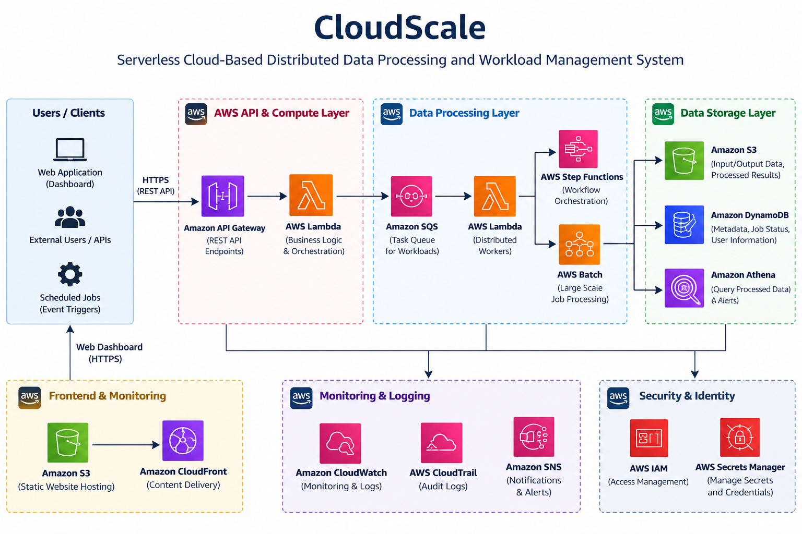

# CloudScale
### A Serverless Cloud-Based Distributed Data Processing and Workload Management System Using AWS

CloudScale is an academic cloud computing project developed to demonstrate asynchronous job submission, queue-based processing, workload distribution, and job status tracking using AWS serverless services.

The system separates job submission from processing and uses cloud-managed services to support scalable, modular, and reliable data-processing workflows.

## System Architecture



## Key Features

- Asynchronous job submission and processing
- Queue-based workload management using Amazon SQS
- Job status tracking and metadata management
- Input and output data storage using Amazon S3
- Job records stored in Amazon DynamoDB
- Error handling and dead-letter queue support
- Serverless deployment using AWS SAM

## Technology Stack

- **Programming Language:** Python
- **API:** Amazon API Gateway
- **Compute:** AWS Lambda
- **Messaging:** Amazon SQS
- **Database:** Amazon DynamoDB
- **Object Storage:** Amazon S3
- **Infrastructure as Code:** AWS SAM

## Project Structure

```text
CloudScale/
├── backend/       # Backend processing functions
├── events/        # Sample job events
├── frontend/      # Web interface
├── tests/         # Unit tests
├── architecture.png
├── template.yaml  # AWS SAM infrastructure template
└── README.md
```

## Getting Started

1. Clone this repository.
2. Review the prerequisites and deployment instructions in the project files.
3. Configure your AWS credentials and deployment settings.
4. Deploy the application using AWS SAM.
5. Test job submission and status tracking using the provided sample events.

**Note:** AWS account setup, service permissions, and deployment configuration are required to run the cloud application. AWS usage may incur charges.

## Testing

Review the `tests/` directory for unit tests. Follow the project instructions to install any required dependencies and run the tests locally.

## Project Goals

- Demonstrate serverless cloud application design
- Explore asynchronous processing and workload management
- Practice infrastructure as code
- Understand modular and scalable distributed processing

## Academic Project

Developed as part of the M.E. Software Systems program.

